# Lumen: AI Video Summaries and Quizzes

Lumen is a Go web application that turns educational videos into structured learning materials. Upload a lecture, talk or tutorial (or import a supported URL), and Lumen will:

- extract or generate a transcript,
- write a coherent summary with an overview, a detailed explanation, key takeaways, important concepts, a timestamped topic breakdown and extra learning notes,
- generate quizzes grounded in what the video actually says, and
- grade your answers with explanations and links back to the relevant moment in the video.

It is a server-rendered application: Go `net/http` and `html/template`, plain CSS, and a small amount of vanilla JavaScript for progressive enhancement. There are no frontend frameworks and no build step.

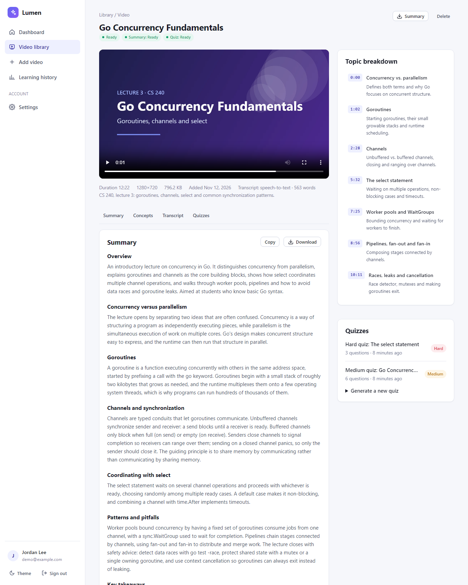

## Screenshots

The screenshots below use a demo account with sample content.

| | |
|---|---|
| **Dashboard.** Learning stats, recent videos and quiz scores.<br>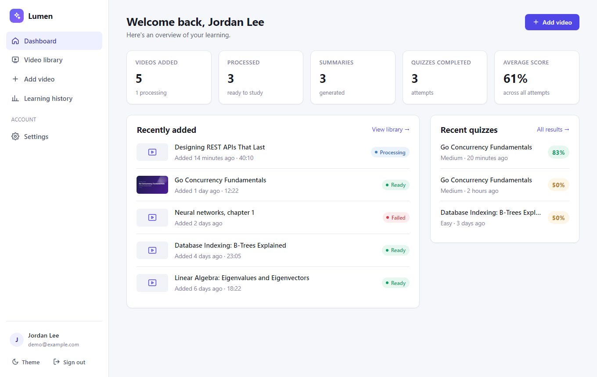 | **Video library.** Search, status filter, sorting and per-stage status badges.<br>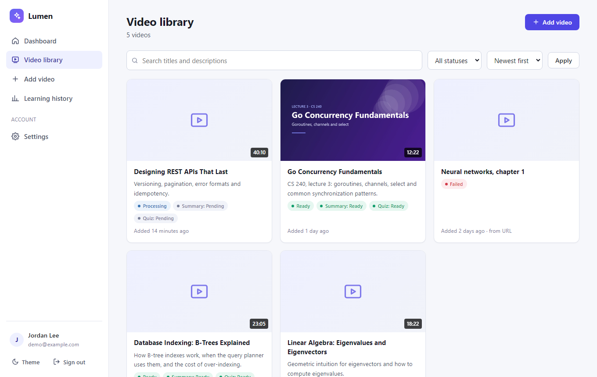 |
| **Add a video.** Upload with a progress bar, or import from a URL, with an optional caption file.<br>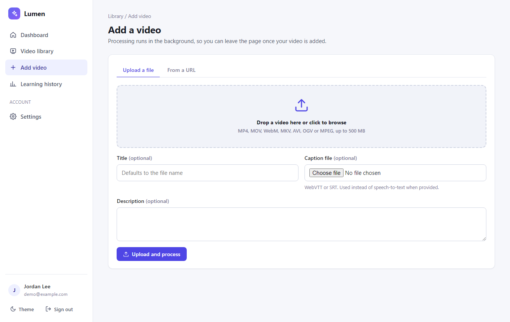 | **Background processing.** Live stage and progress updates; you can leave the page.<br>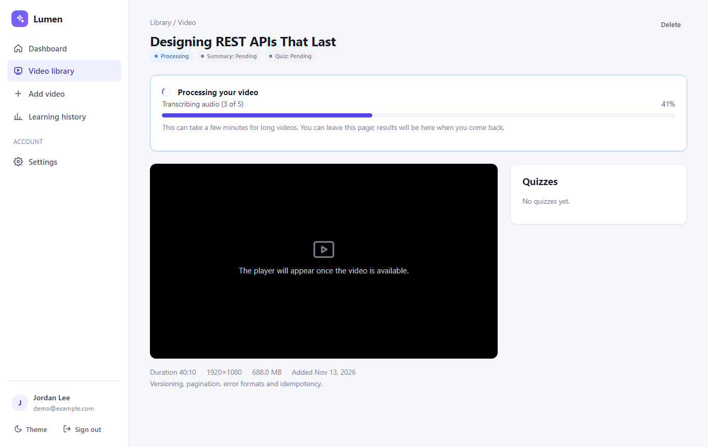 |
| **Transcript.** Search, timestamps that seek the player, copy and download.<br>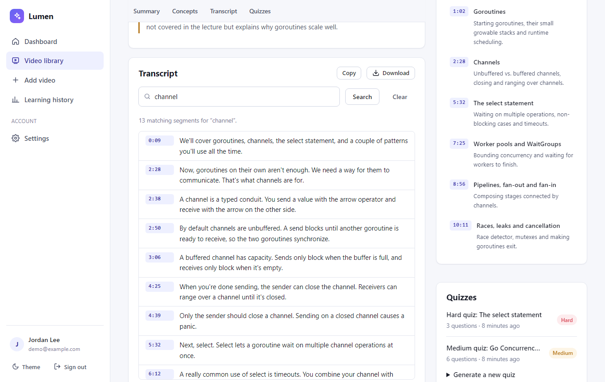 | **Taking a quiz.** One question at a time, with progress and navigation.<br>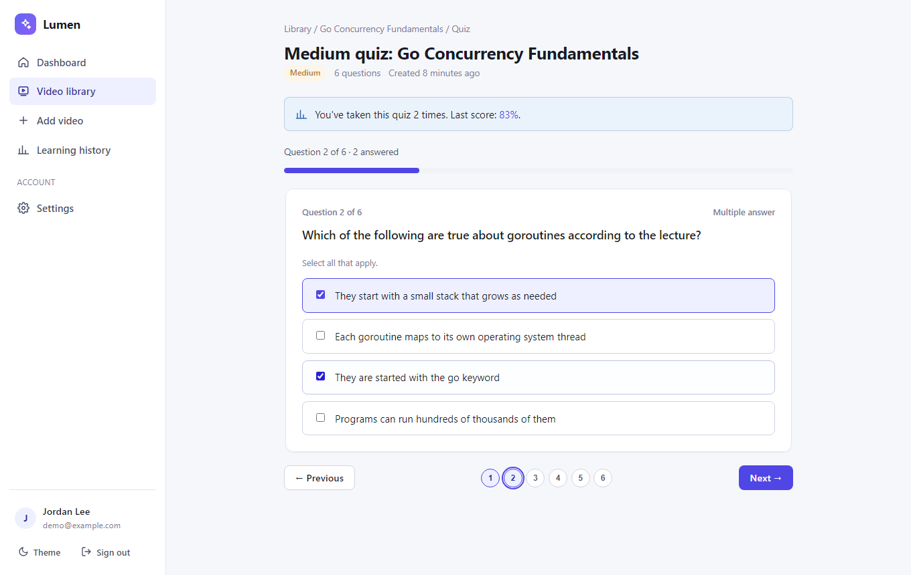 |
| **Quiz results.** Score, correct answers, why each option is right or wrong, and links to the moment in the video.<br>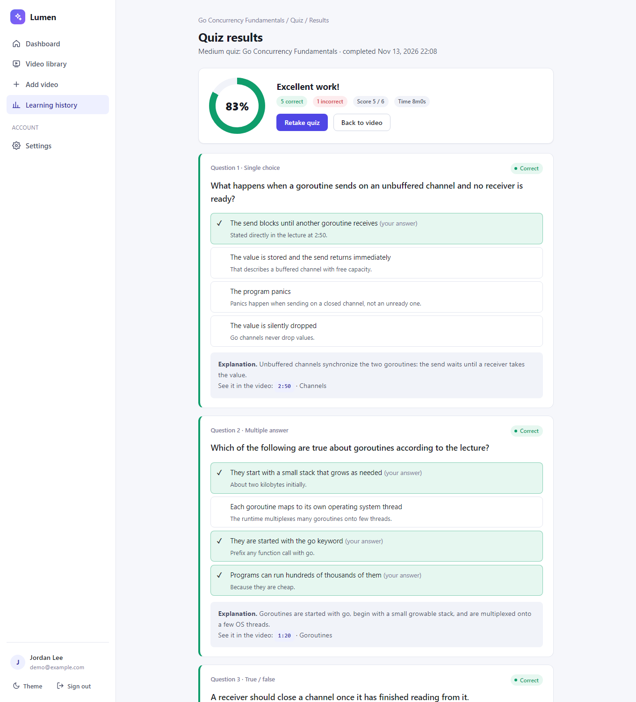 | **Learning history.** Every completed quiz, ready to review or retake.<br>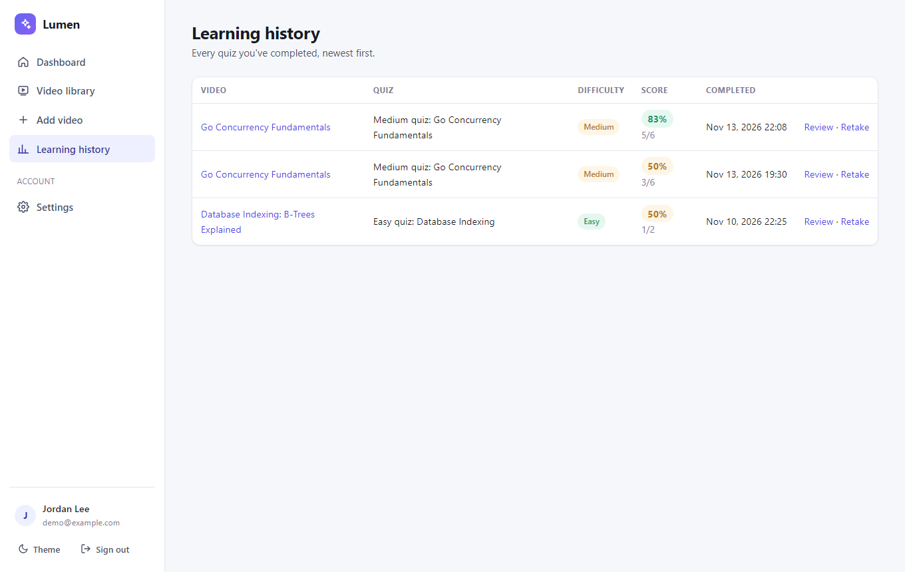 |
| **Dark theme.** Follows the system setting, with a manual toggle.<br>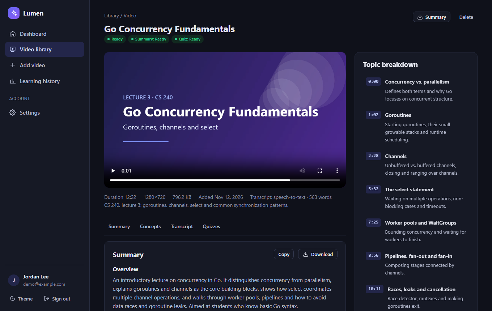 | **Landing page.**<br>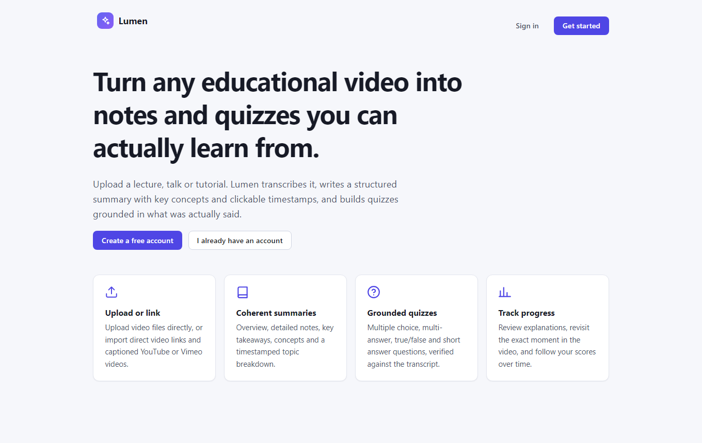 |

<p align="center">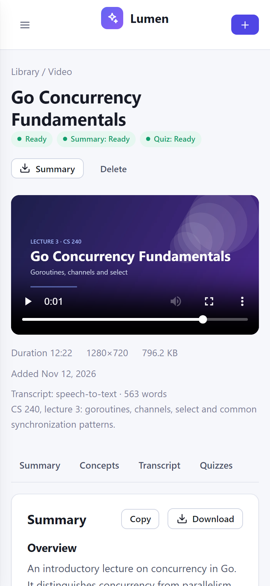<br><em>Responsive layout on a phone</em></p>

## Features

- **Accounts:** registration, login and logout, password reset by email, profile and password management, and account deletion. Sessions are secure, with sliding expiry.
- **Video library:** a dashboard with search, a status filter and sort by date. Each card shows a thumbnail, duration, the processing status, and separate summary and quiz statuses.
- **Adding videos**
  - **Direct upload.** Streams to disk with a progress bar and a configurable size limit, and validates both the extension and the container signature. Optionally attach a `.vtt` or `.srt` caption file.
  - **URL import.** Direct links to video files are downloaded and processed. YouTube and Vimeo links get public oEmbed metadata and an embedded player, and must be paired with a caption file (see [Video URLs](#video-urls)).
- **Background processing:** a database-backed job queue with configurable concurrency, progress tracking, retries with exponential backoff for temporary failures, per-job timeouts, protection against duplicate processing, and recovery of jobs interrupted by a restart. You can close the page and come back later.
- **Summaries:** long transcripts are chunked into notes and then synthesized into one coherent document. Context that wasn't stated in the video is labeled separately. Summaries can be copied or downloaded as Markdown.
- **Transcripts:** stored separately from summaries, with pagination, search, timestamps (click one to seek the player), copy and download.
- **Quizzes:** single choice, multiple answer, true/false and short answer. You configure the number of questions, the difficulty, the question types, and whether to cover the whole video or one section. Every question is validated, then checked by a separate verification pass against the transcript. If there isn't enough content, the quiz has fewer questions and explains why.
- **Quiz taking:** one question at a time with navigation and progress, then results showing the score, the correct answers, explanations for each option, and timestamp links. Short answers are graded deterministically first, and the AI is consulted only for semantic equivalence. It can never change the answer key.
- **Learning dashboard and history:** totals, average score, recent videos and recent results.
- **Light and dark themes:** follows your system setting by default, with a manual toggle.

## Technology stack

| Concern | Choice |
|---|---|
| Language / HTTP | Go 1.26, standard `net/http` routing (method and path patterns) |
| Templates | `html/template` (embedded with `embed`) |
| Database | SQLite through [`modernc.org/sqlite`](https://pkg.go.dev/modernc.org/sqlite), pure Go with no CGO or C compiler needed |
| Logging | `log/slog` (text or JSON) |
| Passwords | bcrypt (`golang.org/x/crypto/bcrypt`) |
| AI | Anthropic Claude through the official [Go SDK](https://github.com/anthropics/anthropic-sdk-go), or any OpenAI-compatible Chat Completions API |
| Speech-to-text | OpenAI Whisper-compatible `/audio/transcriptions` API |
| Media | FFmpeg and ffprobe (external binaries) |
| Frontend | Plain CSS and vanilla JavaScript |

## Prerequisites

- **Go 1.26 or newer**
- **FFmpeg** (includes `ffprobe`). It's needed for video metadata, thumbnails, embedded subtitles and audio extraction. Without it, the app still runs, but only videos uploaded with a caption file can be processed.
  - Windows: `winget install Gyan.FFmpeg` (or download from https://www.gyan.dev/ffmpeg/builds/ and add `bin` to `PATH`)
  - macOS: `brew install ffmpeg`
  - Debian/Ubuntu: `sudo apt install ffmpeg`
  - Check with `ffmpeg -version` and `ffprobe -version`. If they aren't on `PATH`, set `FFMPEG_PATH` and `FFPROBE_PATH` to the full paths.
- **An AI provider API key** (Anthropic or OpenAI-compatible).
- **A speech-to-text API key** (OpenAI Whisper or a compatible service) to transcribe videos that have no captions. This is optional if every video comes with captions.

## Installation

```sh
git clone <repository-url> ai-video-summarizer
cd ai-video-summarizer
go mod download
cp .env.example .env      # then edit .env (see Configuration)
```

## Configuration

All configuration comes from environment variables. For convenience, a `.env` file in the working directory is loaded at startup; real environment variables take precedence over it. See [`.env.example`](.env.example) for every option.

**Required:**

| Variable | Description |
|---|---|
| `SESSION_SECRET` | At least 32 random characters, used to sign CSRF tokens. Generate one with `openssl rand -hex 32`. |
| `AI_API_KEY` | API key for the AI provider. |
| `STT_API_KEY` | Required when `STT_PROVIDER=openai` (the default). Set `STT_PROVIDER=none` to run without speech-to-text. |

**Common optional settings:**

| Variable | Default | Description |
|---|---|---|
| `APP_ADDR` | `:8080` | Listen address. |
| `APP_BASE_URL` | `http://localhost:8080` | Public URL, used in password-reset links. `https://` URLs turn on secure cookies and HSTS. |
| `DATABASE_PATH` | `data/app.db` | SQLite database file. |
| `UPLOAD_DIR` | `data/uploads` | Where videos, captions and thumbnails are stored. |
| `MAX_UPLOAD_MB` | `500` | Maximum video upload (and URL download) size. |
| `PROCESSING_CONCURRENCY` | `2` | Number of videos processed in parallel. |
| `PROCESSING_TIMEOUT` | `60m` | Maximum time for one processing job. |
| `JOB_MAX_ATTEMPTS` | `3` | Attempts before a temporary failure becomes permanent. |
| `SESSION_TTL` | `168h` | Session lifetime (extended while you use the app). |
| `LOG_LEVEL` / `LOG_FORMAT` | `info` / `text` | Use `LOG_FORMAT=json` for structured log collectors. |
| `SMTP_HOST`, `SMTP_PORT`, `SMTP_USERNAME`, `SMTP_PASSWORD`, `SMTP_FROM` | unset | Enables password-reset emails. |

The server refuses to start if a required setting is missing or invalid, and lists every problem at once.

### AI provider configuration

The pipeline depends only on the `ai.Provider` interface (`internal/ai`), so providers can be swapped without touching the processing code.

- **Anthropic (default):** `AI_PROVIDER=anthropic`, `AI_API_KEY=<your Anthropic key>`. The default model is `claude-opus-5-5` (override with `AI_MODEL`). Requests use streaming, structured JSON output, effort control, and Anthropic's server-side refusal fallback, so a request declined by a safety classifier is retried with a suitable fallback model.
- **OpenAI or a compatible API:** `AI_PROVIDER=openai`, `AI_API_KEY=...`, an optional `AI_MODEL` (default `gpt-4o`), and an optional `AI_BASE_URL` for compatible endpoints. The model must support JSON-schema structured output.

The AI is used for summaries, concept extraction, quiz generation, quiz verification, and judging semantic equivalence of short answers.

### Transcription provider configuration

- `STT_PROVIDER=openai` with `STT_API_KEY`, plus optional `STT_MODEL` (default `whisper-1`) and `STT_BASE_URL` (default `https://api.openai.com/v1`). Any service that implements the OpenAI `/audio/transcriptions` API works, such as Groq with `STT_BASE_URL=https://api.groq.com/openai/v1` and `STT_MODEL=whisper-large-v3`. Whisper models return segment timestamps; other models return plain text without timestamps.
- `STT_PROVIDER=none` turns speech-to-text off. Videos without captions then fail with a clear message asking for a caption file.

## Database migrations

Migrations are embedded SQL files in `internal/db/migrations/`. They are applied automatically at startup, in order, each in its own transaction, and recorded in `schema_migrations`. To apply them without starting the server:

```sh
go run ./cmd/server migrate
```

To add a migration, create the next numbered file (for example `0002_add_x.sql`). Applied migrations must never be edited.

## Running the application

```sh
go run ./cmd/server            # or: go build -o bin/server ./cmd/server && ./bin/server
```

Then open http://localhost:8080, create an account and add a video.

**Admin commands:**

```sh
go run ./cmd/server migrate                    # apply migrations and exit
go run ./cmd/server reset-link user@example.com  # print a one-hour password reset link
```

`reset-link` is how operators handle password resets when SMTP isn't configured.

Press Ctrl+C to shut down gracefully. In-flight HTTP requests finish, and running jobs are returned to the queue and resume on the next start.

## Running the tests

```sh
go test ./...                                   # everything
go test ./internal/quiz                         # one package
go test ./internal/web -run TestVideoUpload -v  # one test
gofmt -l . && go vet ./...                      # formatting and static checks
```

The tests make no network calls and incur no API costs. AI and speech-to-text providers are replaced by mocks (`internal/ai/aitest`), media tools by fakes, and each test uses a temporary SQLite database. The suite includes:

- unit tests for transcript processing, summary processing, quiz validation, grading and input validation
- HTTP handler tests for authentication, CSRF, uploads, URL submission, summaries, quizzes and authorization between users
- integration tests for the database, the job lifecycle and the full processing pipeline

It also covers failure cases: failed processing, malformed AI responses, empty transcripts, oversized uploads and unauthorized access.

## Video uploads and limitations

- **Accepted formats:** MP4/M4V, MOV, WebM, MKV, OGV, AVI and MPEG. The file's container signature is checked, so renamed non-video files are rejected.
- **Size:** limited by `MAX_UPLOAD_MB` (default 500 MB). If you run behind a reverse proxy, raise its body size limit too (for example nginx `client_max_body_size`).
- **Captions:** WebVTT (`.vtt`) or SubRip (`.srt`), up to 5 MB. When a caption file is provided, it is used instead of speech-to-text.
- **Storage:** files are kept on the local filesystem under `UPLOAD_DIR`, using random server-generated names; only metadata lives in SQLite. Deleting a video removes its files and all of its transcripts, summaries, quizzes and results.
- **Playback:** the browser plays uploaded files directly. Formats some browsers can't play, such as MKV or AVI in Safari, can still be processed and summarized, but the player may show a download link instead.

### Video URLs

Lumen only uses legitimate access methods. It never bypasses authentication, DRM or platform restrictions.

| URL type | What happens |
|---|---|
| Direct link to a video file (`https://…/talk.mp4`) | Downloaded (within the size limit) and processed like an upload. |
| YouTube / Vimeo | Title, author and thumbnail are fetched from the public oEmbed API, and the video plays in the platform's embedded player. These platforms don't let third-party apps download videos or transcripts, so **a caption file is required** (owners can export captions from YouTube Studio or Vimeo). |
| Anything else | Rejected with an explanation, suggesting a direct upload instead. |

**URL safety:** the server blocks SSRF. Submitted hosts are resolved and rejected if they map to loopback, private, link-local or other internal ranges. The download client re-checks every connection at dial time, which also blocks DNS rebinding, ignores proxy environment variables and limits redirects.

## The video processing pipeline

When a video is added, a `process_video` job is queued (at most one active job per video and job type), and a worker from the pool picks it up:

1. **Validate the input.** Uploads are checked when they are received. URLs are classified and their hosts checked again.
2. **Fetch.** For direct URLs, the file is downloaded with progress reporting. For YouTube/Vimeo, oEmbed metadata is fetched.
3. **Extract metadata** with ffprobe (duration, resolution, embedded title or description), and render a thumbnail with ffmpeg.
4. **Find existing captions.** A caption file you supplied is used first, then any embedded text subtitle track (English preferred).
5. **Extract audio** if there are no captions: mono 16 kHz MP3, split into 10-minute segments.
6. **Transcribe** each segment with the speech-to-text provider, shifting timestamps by each segment's offset.
7. **Store** the transcript and its timed segments.
8. **Clean and normalize** the text: strip markup and non-speech tags like `[Music]`, and remove duplicate text from rolling auto-captions.
9. **Chunk** long transcripts into overlapping, timestamp-annotated pieces.
10. **Prepare** each chunk: the AI extracts structured notes (topics, points, terms), not standalone summaries.
11. **Summarize.** A single synthesis request writes one coherent document from all the notes, which are condensed hierarchically first for very long videos.
12. **Extract concepts and takeaways** as part of the same schema-validated output. The results are de-duplicated and timestamps are clamped to the video length.
13. **Generate a default quiz.** Questions are validated, de-duplicated, then verified against the transcript.
14. **Save the results.**
15. **Mark the job complete.**

**Reliability:**

- Temporary errors (rate limits, 5xx responses, network timeouts) are retried with exponential backoff, up to `JOB_MAX_ATTEMPTS`.
- Retries reuse stages that already finished, so a transcript isn't regenerated just because summarization hit a rate limit.
- Permanent failures store a user-safe message on the video, which shows a "Try again" button.
- Jobs are bounded by `PROCESSING_TIMEOUT`.
- On restart, jobs that were running are requeued, and leftover temporary files are cleaned up.

Quizzes you request from a video page run as separate `generate_quiz` jobs.

## Security notes

- Passwords are hashed with bcrypt (cost 12). Login takes about the same time whether or not the account exists.
- Session tokens are random and stored only as SHA-256 hashes, sent in `HttpOnly`, `SameSite=Lax` cookies (`Secure` over HTTPS), with sliding expiration. All sessions are revoked when the password changes or is reset.
- CSRF protection uses signed double-submit tokens on every state-changing request, plus Origin and `Sec-Fetch-Site` checks.
- Per-IP or per-user rate limits apply to login, registration, password reset, uploads, quiz generation and submissions.
- Every query on user data is scoped by user id. Another user's resources return 404.
- All SQL is parameterized, and `LIKE` wildcards are escaped.
- File paths are built from validated, server-generated keys, which prevents path traversal.
- A strict Content-Security-Policy (no inline scripts or styles), plus `X-Frame-Options`, `nosniff` and a Referrer-Policy.
- Internal errors are logged with `slog` but never shown to users. API keys, passwords and tokens are never logged.

## Project layout

```
cmd/server/          entrypoint: configuration, wiring, graceful shutdown, admin commands
internal/config/     environment configuration and .env loading
internal/db/         SQLite connection and embedded migrations
internal/store/      data access (parameterized SQL, ownership-scoped queries)
internal/model/      domain types
internal/auth/       registration, login, sessions, password resets, SMTP mailer
internal/library/    business logic for adding/deleting videos and requesting quizzes
internal/jobs/       background worker pool (claiming, retries, timeouts)
internal/pipeline/   video processing pipeline and upload validation
internal/media/      ffprobe/ffmpeg wrapper
internal/stt/        speech-to-text providers
internal/ai/         AI provider interface, Anthropic and OpenAI implementations, test mock
internal/transcript/ caption parsing, normalization, chunking
internal/summary/    summary generation
internal/quiz/       quiz generation, validation, verification and grading
internal/urlimport/  URL classification, oEmbed, SSRF-safe downloads
internal/storage/    local file storage
internal/web/        routes, middleware, handlers, templates and static assets
```
